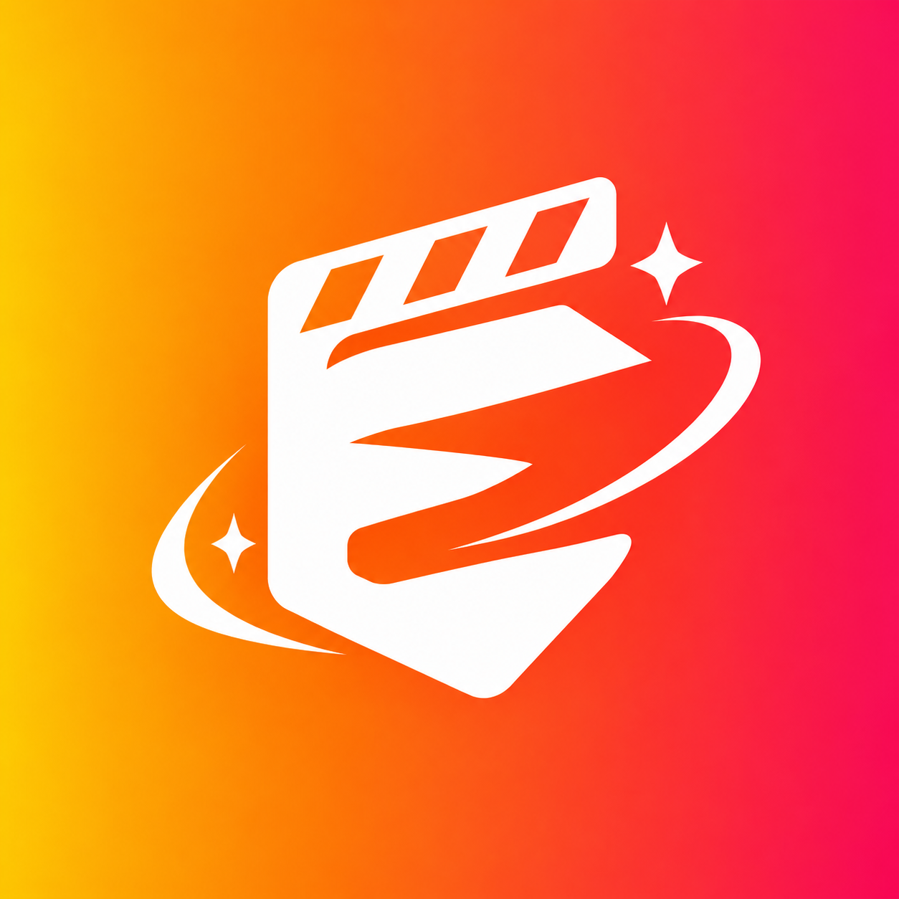

<p align="center">
  
</p>

<h1 align="center">Eeyditor</h1>

<p align="center">
  <em>A fast, precise desktop video editor — frame-accurate trimming, a canvas
  timeline, a Bézier keyframe engine and deterministic FFmpeg rendering.</em>
</p>

<p align="center">
  <a href="LICENSE"></a>
  
  
  
  
  
  
</p>

Eeyditor is original software released under the **GNU General Public License
v3.0**. It pairs a Rust/Tauri host with a React + TypeScript editing surface: a
canvas-rendered 60 fps timeline, a real-media program monitor, and a filtergraph
compiler that turns a `.eeyproj` manifest into a single, reproducible `ffmpeg`
invocation.

## Status

Eeyditor is an **early, working build** — a solid vertical slice, not yet a
production-complete editor. The editing core, project format, monitor and render
pipeline are functional and tested; several editor conventions are still stubbed
or missing (see [Known limits](#known-limits)).

| Area | State |
| ---- | ----- |
| Project schema, save/load, undo/redo | ✅ working |
| Canvas timeline (trim, move, blade, ripple, snap, zoom) | ✅ working |
| Bézier keyframe engine + curve editor | ✅ working |
| Media import with real ffprobe metadata | ✅ working |
| Program monitor with real video/image/audio playback | ✅ working (codec-dependent) |
| Deterministic FFmpeg export (verified end-to-end) | ✅ working |
| Transitions in monitor and export | ✅ fade, dissolve, wipe, slide |
| Effect stack in monitor and export | ✅ working (core subset, incl. chroma key) |
| Real waveforms, track mixer, multi-select, clipboard | ✅ working |
| Clip link groups (move/trim/split/delete together) | ✅ working |
| SRT subtitle import, monitor overlay and burn-in | ✅ working |
| CI (typecheck, tests, build, cargo check) | ✅ configured |
| Release bundles on `v*` tags (draft) | ✅ configured |
| Auto-update | ❌ not yet |

## Features

- **Canvas timeline** rendered at 60 fps with infinite zoom, magnetic snapping
  (snap-to-cut, snap-to-edge, snap-to-marker), frame-accurate `HH:MM:SS:FF`
  timecode and virtualized clip drawing.
- **Keyframe engine** with linear, hold and cubic Bézier interpolation, an
  interactive Bézier curve editor and per-property animation for opacity, scale,
  position, rotation and volume.
- **Real-media program monitor** that decodes imported video and images through
  Tauri's asset protocol, composites frames with the same transform matrix as the
  export pipeline, plays real audio (per-clip gain and fades) and draws a live
  analyser scope.
- **Deterministic export** that compiles the timeline into one FFmpeg
  `filter_complex` graph — generated background, scaled/padded/rotated overlays,
  keyframed transforms, animated opacity and audio mixing — then renders through
  the Rust host.
- **Real audio waveforms** decoded on the Rust side via FFmpeg (min/max/RMS
  buckets) and cached per source, with a synthetic fallback for generators.
- **Track mixer and multi-select** — per-track mute/solo/lock/hide, dB gain,
  shift/ctrl multi-selection with group move, and copy/cut/paste/duplicate for
  clip groups.
- **Media import with poster thumbnails** captured in the webview and kept in
  memory so project files stay small.
- **Live export progress and cancellation** — the host streams FFmpeg's
  `-progress` output, and a running render can be cancelled from the export panel.
- **Subtitles** — import SubRip (`.srt`), add cues at the playhead, preview them
  in the monitor and burn them into the export with timed `drawtext`.
- **Spatial transitions** — wipes and slides are geometric in both the monitor
  and the render graph; fades and dissolves use an opacity ramp.
- **Clip link groups** — link any selection so move, trim, split and delete stay
  in sync across tracks.
- **Tactile dark neumorphism** design system with a sampled brand gradient.

## Stack

| Layer | Technology |
| ----- | ---------- |
| Shell | Tauri 2 (Rust) |
| UI | React 18 + TypeScript 5 |
| Styling | Tailwind CSS |
| Icons | Lucide |
| Build | Vite |
| Tests | Vitest |
| Rendering | FFmpeg / ffprobe |

## Architecture

```
src/
  assets/logo.png            app icon, titlebar and splash branding
  types/timeline.ts          the .eeyproj schema (single source of truth)
  core/
    project/factory.ts       project, track, clip and preset factories
    project/serialize.ts     validation + serialize/parse round trip
    keyframes/bezier.ts      cubic Bézier solver and curve evaluation
    timeline/engine.ts       timecode, snapping, trim, split, ripple edits
    audio/waveform.ts        peak extraction, envelopes, gain math
    media/probe.ts           ffprobe JSON reduction (duration, fps, streams)
    exporter/FFmpegBridge.ts filtergraph compiler
  state/editorStore.ts       observable store, undo/redo, gestures
  components/
    neumorphic/              the component kit
    timeline/                Timeline + KeyframeTrack (canvas)
    player/PreviewPlayer.tsx media-decoding monitor (canvas + audio)
    layout/                  TitleBar, Splash, MediaBin, Inspector, ExportPanel
  hooks/                     playback clock + keyboard shortcuts
src-tauri/                   Rust host: save/load, ffmpeg, ffprobe
tests/                       Vitest suites (schema, keyframes, timeline, export, probe, media)
```

## Design system

Brand gradient:

```css
linear-gradient(135deg, #FFB300 0%, #FF5100 50%, #E60067 100%)
```

| Token         | Value     |
| ------------- | --------- |
| Canvas        | `#121318` |
| Elevated      | `#1A1B23` |
| Recessed      | `#16171F` |
| Neon Amber    | `#FFB300` |
| Magma Orange  | `#FF5100` |
| Electric Pink | `#E60067` |

The `NeumorphicButton`, `NeumorphicPanel`, `NeumorphicTrackSlot`,
`NeumorphicKnob` and `NeumorphicSlider` components implement the raised and
recessed illumination model.

## Project format

Projects serialize to `.eeyproj`, a JSON manifest. The schema validates and
normalizes on load and round-trips deterministically:

```
EeyditorProject
├─ resolution, frameRate, sampleRate, duration
├─ tracks: TimelineTrack[]        (video | overlay | effects | text | audio | adjustment)
│   └─ clips: TimelineClip[]
│       ├─ transform: KeyframeCurve per property
│       ├─ volume: AudioEnvelope
│       ├─ effects, transitionIn/Out, text
├─ media: MediaSource[]
├─ markers, renderPreset, metadata
```

## Export pipeline

`buildFfmpegPlan(project, output)` produces:

1. a generated background (`lavfi color`), so gaps resolve to black;
2. one scaled/padded/rotated, alpha-blended stream per visual clip, shifted onto
   the timeline with `setpts`;
3. bottom-up `overlay` composition gated by `between(t, …)`;
4. audio `atrim`/`atempo`/`volume`/`afade`/`adelay` chains mixed with `amix`;
5. codec arguments for CPU (CRF) or hardware (NVENC) presets.

Animated opacity is compiled to a bounded luma mask combined with `alphamerge`,
which keeps the per-frame cost constant regardless of keyframe density.

## Getting started

Prerequisites: **Node 20+** (or 22+), **Rust** (stable) and FFmpeg on `PATH`.
Linux also needs the Tauri system libraries (`webkit2gtk-4.1`, `gtk+-3.0`,
`libsoup-3.0`).

```bash
npm install
npm run dev            # Vite dev server
npm run test           # Vitest (72 tests)
npm run typecheck      # tsc --noEmit
npm run build          # typecheck + production bundle
npm run tauri:dev      # desktop app
npm run tauri:build    # bundled desktop build
```

## Verification status

| Gate                 | Result                     |
| -------------------- | -------------------------- |
| `tsc --noEmit`       | clean                      |
| `vitest run`         | 72 / 72 passed             |
| `vite build`         | success                    |
| `cargo check`        | success                    |
| FFmpeg end-to-end    | 11 / 11 renders passed     |
| GitHub Actions CI    | web + Rust jobs            |

Rendered fixtures cover empty projects, plain clips, keyframed scale, animated
opacity (verified monotonic via luma sampling), text overlays, audio-only
timelines, wipes, slides, subtitle burn-in and the full demo project
(1920×1080 / 60 fps / H.264 + AAC, 24 s). Wipe and slide geometry was verified
by sampling per-column luma across the transition.

## Roadmap

- [x] Project schema, serialization and undo/redo
- [x] Canvas timeline with snapping and frame-accurate edits
- [x] Bézier keyframe engine and curve editor
- [x] Deterministic FFmpeg export pipeline
- [x] Real media probing, monitor playback and audio
- [x] Transition rendering in monitor and export
- [x] Effect parity between monitor and export (core subset)
- [x] Real timeline waveforms and a track mixer
- [x] Multi-select, group move and clipboard operations
- [x] CI: typecheck, unit tests, web build and `cargo check`
- [x] Clip link groups and SRT subtitles
- [x] Tag-triggered release bundles for Linux, macOS and Windows
- [ ] Auto-update and code signing

## Known limits

- Monitor playback depends on the platform webview codecs (WebKitGTK +
  GStreamer on Linux); unsupported files fall back to a labelled placeholder.
- The monitor applies blur, brightness, contrast, saturation, hue, glow,
  vignette and chroma key; sharpen and LUT effects remain export-only (`lut` is
  currently a no-op in both paths; no LUT file picker exists).
- Zoom transitions currently render as fades rather than a spatial zoom.
- Subtitle styling is fixed (white, bottom-centred, translucent box); there is no
  per-cue font or position control yet.
- Clip link groups are created manually; importing a file does not auto-split its
  audio into a linked track.
- Timeline waveforms require the desktop host to decode audio; browser-only
  development falls back to synthesized peaks.
- Release bundles are produced only when a `v*` tag is pushed; this revision
  ships no binaries and has no auto-update or signing.

## Contributing

Issues and pull requests are welcome. Please run `npm run typecheck` and
`npm run test` before opening a PR, keep commits in Conventional Commit form
(`feat:`, `fix:`, `docs:`) and match the surrounding code style.

## License

GNU General Public License v3.0 — see [`LICENSE`](LICENSE).
